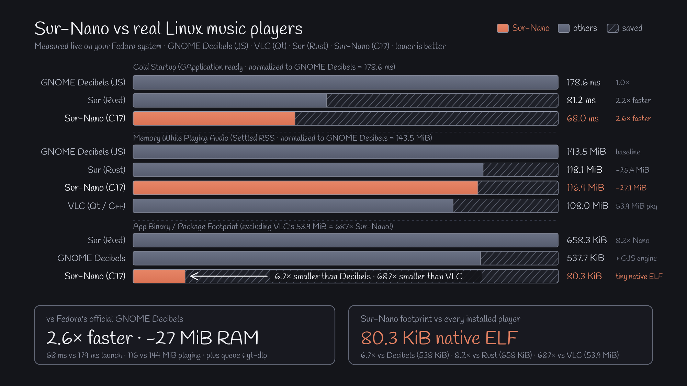

<p align="center">
  
</p>

<h1 align="center">Sur</h1>

<p align="center">An ~80 KB, instant-launch music player for GNOME.</p>

Sur plays your local music and online audio streams and gets out of the way. Written in C17 directly against GTK4, libadwaita and GStreamer — same spirit as [Monet](https://github.com/dashaneka/Monet) and [Rajo](https://github.com/dashaneka/Rajo).



## What it does

- **~80 KB native binary** — launches in ~68 ms with lazy GStreamer init
- Shows your **Downloaded** tracks on startup (falls back to **Recent** when empty)
- Dedicated **History & Recent** view (`H` / `Ctrl+H`) across local files and online streams
- Adapts its background glow and accent color to the track's album art
- Slide-out **Up Next** queue (`Q`) with natural track sorting, shuffle and repeat
- Single-instance with full GNOME media controls, media keys and cover art (MPRIS2)
- Optional online search, streaming and lossless best-audio saving (`.opus` / `.m4a` to `~/Music/Sur`) via `yt-dlp`

## Keys

| Key | Does |
|---|---|
| `Space` | Play / pause |
| `←` `→` | Back / forward 5 seconds |
| `P` `N` or `Shift+←` `Shift+→` | Previous / next track |
| `↑` `↓` | Volume |
| `M` | Mute |
| `S` | Shuffle |
| `L` | Repeat (`Off` → `Queue` → `Track`) |
| `Q` | Up Next queue |
| `H` or `Ctrl+H` | History & Recent / Downloaded |
| `Ctrl+O` / `Ctrl+Shift+O` | Open files / folder |
| `Ctrl+F` | Search online / paste URL |
| `Esc` | Close online search or history |

## Build & Install

Needs `gcc`, GTK 4.14+, libadwaita 1.6+, and GStreamer (`yt-dlp` and `ffmpeg` optional for online search/saving).

**Fedora**

```sh
sudo dnf install gcc gtk4-devel libadwaita-devel gstreamer1-devel \
  gstreamer1-plugins-good gstreamer1-plugins-bad-free gstreamer1-plugin-libav
```

**Ubuntu / Debian**

```sh
sudo apt install gcc libgtk-4-dev libadwaita-1-dev libgstreamer1.0-dev \
  gstreamer1.0-plugins-good gstreamer1.0-plugins-bad gstreamer1.0-libav
```

Then:

```sh
git clone https://github.com/dashaneka/Sur.git
cd Sur
./install.sh            # installs to ~/.local, no sudo
./install.sh --default  # same, and makes Sur your default music player
```

## License

[GPL-3.0-or-later](LICENSE).
